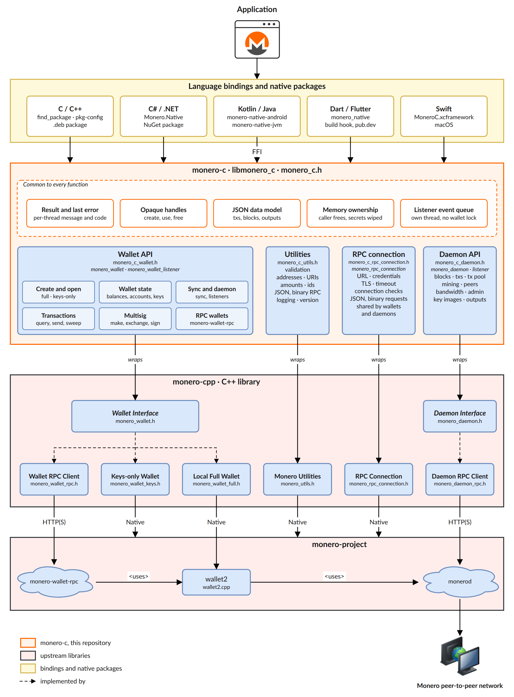

# Monero C

[](https://github.com/libmonero/monero-c/actions/workflows/build.yml)
[](https://github.com/libmonero/monero-c/actions/workflows/unit-tests.yml)
[](https://github.com/libmonero/monero-c/actions/workflows/integration-tests.yml)

[](https://app.codacy.com/gh/libmonero/monero-c/dashboard?utm_source=gh&utm_medium=referral&utm_content=&utm_campaign=Badge_grade)
[](https://app.codacy.com/gh/libmonero/monero-c/dashboard?utm_source=gh&utm_medium=referral&utm_content=&utm_campaign=Badge_coverage)
[![License](https://img.shields.io/badge/license-MIT-green?logo=%3D%3D)](https://github.com/libmonero/monero-c/blob/main/LICENSE)

[](https://libmonero.github.io/monero-c/monero__c_8h.html)
[](https://libmonero.github.io/monero-c/)
[](https://matrix.to/#/#monero-c:monero.social)

> [!WARNING]
>
> monero-c is currently under maintenance and unfunded, expect bugs and breaking changes.

A C ABI for creating Monero applications using RPC and FFI bindings to [monero v0.18.5.4 'Fluorine Fermi'](https://github.com/monero-project/monero/tree/v0.18.5.4).

* Supports wallet and daemon RPC clients.
* Supports client-side wallets using native bindings.
* Supports multisig, view-only, and offline wallets.
* Wallet types are interchangeable behind a common interface.
* Uses a clearly defined [data model and API specification](docs/monero-spec.pdf) intended to be intuitive and robust.
* Query wallet transactions, transfers, and outputs by their properties.
* Fetch and process binary data from the daemon (e.g. raw blocks).
* Receive notifications when blocks are added to the chain or when wallets sync, send, or receive.

## Architecture

<p align="center">
	<br>
	<i>Applications call monero-c through FFI bindings in their own language. monero-c exposes the wallet, the daemon, the RPC connection and the utilities of <a href="https://github.com/woodser/monero-cpp">monero-cpp</a> as a C ABI, with opaque handles, JSON data and listener callbacks, and monero-cpp reaches <a href="https://github.com/monero-project/monero">monero-project/monero</a>.  Wallet implementations are interchangeable by conforming to a common interface, <a href="https://woodser.github.io/monero-cpp/doxygen/classmonero_1_1monero__wallet.html">monero_wallet.h</a>.</i>
</p>

## Sample code

```c
#include <stdio.h>
#include "monero_c.h"

static void on_sync_progress(void* user_data, uint64_t height, uint64_t start_height, uint64_t end_height, double percent_done, const char* message) {
  // feed a progress bar?
}

static void on_output_received(void* user_data, const char* output_json) {
  // JSON-serialized monero_output_wallet, with the amount and the transaction
}

// connect to daemon
monero_daemon* daemon = NULL;
monero_daemon_connect("http://localhost:38081", "superuser", "abctesting123", "", "", 0, &daemon);
uint64_t height = 0;
monero_daemon_get_height(daemon, &height);                      // 1523651
char* txs_in_pool = NULL;
monero_daemon_get_tx_pool(daemon, &txs_in_pool);                // JSON object with the monero_tx in a block
monero_utils_free(txs_in_pool);

// create wallet from mnemonic phrase using native bindings to monero-project
monero_wallet* wallet_full = NULL;
monero_wallet_create_from_seed("sample_wallet_full", "supersecretpassword123", MONERO_UTILS_NETWORK_STAGENET,
                               "hefty value scenic...", "", 573936, NULL, &wallet_full);
monero_wallet_set_daemon_connection(wallet_full, "http://localhost:38081", "superuser", "abctesting123", "", NULL, true); // NULL trusts a local daemon

// synchronize the wallet and receive progress notifications
monero_wallet_listener_callbacks sync_callbacks = {sizeof(monero_wallet_listener_callbacks), NULL, on_sync_progress, NULL, NULL, NULL, NULL};
monero_wallet_listener* sync_listener = NULL;
monero_wallet_listener_create(&sync_callbacks, &sync_listener);
char* sync_result = NULL;
monero_wallet_sync(wallet_full, NULL, sync_listener, &sync_result);
monero_utils_free(sync_result);

// synchronize in the background every 5 seconds
monero_wallet_start_syncing(wallet_full, 5000);

// receive notifications when funds are received, confirmed, and unlocked
monero_wallet_listener_callbacks callbacks = {sizeof(monero_wallet_listener_callbacks), NULL, NULL, NULL, NULL, on_output_received, NULL};
monero_wallet_listener* listener = NULL;
monero_wallet_listener_create(&callbacks, &listener);
monero_wallet_add_listener(wallet_full, listener);

// connect to wallet RPC and open wallet
monero_wallet* wallet_rpc = NULL;
monero_wallet_rpc_open("http://localhost:38083", "rpc_user", "abc123", "sample_wallet_rpc", "supersecretpassword123", &wallet_rpc);
char* primary_address = NULL;
monero_wallet_get_primary_address(wallet_rpc, &primary_address); // 555zgduFhmKd2o8rPUz...
uint64_t balance = 0;
monero_wallet_get_balance(wallet_rpc, &balance);                // 533648366742
char* txs = NULL;
monero_wallet_get_txs(wallet_rpc, NULL, &txs);                  // JSON object with the blocks of the monero_tx_wallet
monero_utils_free(txs);

// send funds from RPC wallet to full wallet
char* address = NULL;
monero_wallet_get_primary_address(wallet_full, &address);
char tx_config[256];
snprintf(tx_config, sizeof(tx_config),
         "{\"accountIndex\":0,\"destinations\":[{\"address\":\"%s\",\"amount\":250000000000}],\"relay\":false}", address);
char* created_tx = NULL;
monero_wallet_create_tx(wallet_rpc, tx_config, &created_tx);   // "Are you sure you want to send... ?"
char* tx_hash = NULL;
monero_wallet_relay_tx_json(wallet_rpc, created_tx, &tx_hash); // relay the transaction
monero_utils_free(created_tx);
monero_utils_free(tx_hash);
monero_utils_free(address);
monero_utils_free(primary_address);

// save and close wallet
monero_wallet_close(wallet_full, true);
monero_wallet_free(wallet_full);
monero_wallet_free(wallet_rpc);
monero_wallet_listener_free(listener);
monero_wallet_listener_free(sync_listener);
monero_daemon_free(daemon);
```

Every call that can fail returns `MONERO_OK` or `MONERO_ERROR`, `monero_last_error()` gives the message, `monero_last_error_code()` the kind of the failure and `monero_last_error_rpc_code()` the code of an RPC error. The sample leaves the checks out. The structs of callbacks start with `struct_size`, which is the `sizeof` of the struct as the program was built with it: a later version can add callbacks at the end, and a program built with this header keeps working.

## Documentation

* [API documentation](https://libmonero.github.io/monero-c/)
* [API and model overview with visual diagrams](https://github.com/libmonero/monero-c/blob/main/docs/monero-spec.pdf)
* [Coverage report](https://libmonero.github.io/monero-c/coverage/)
* [Security policy and release provenance](https://github.com/libmonero/monero-c/blob/main/SECURITY.md)
* [Memory ownership](https://github.com/libmonero/monero-c/blob/main/docs/memory-ownership.md)
* [Thread safety](https://github.com/libmonero/monero-c/blob/main/docs/thread-safety.md)
* [Results with context](https://github.com/libmonero/monero-c/blob/main/docs/results.md) and [JSON shapes](https://github.com/libmonero/monero-c/blob/main/docs/json-shapes.md)
* [Limits, TLS and proxy (Tor)](https://github.com/libmonero/monero-c/blob/main/docs/networking.md)
* [Wallets](https://github.com/libmonero/monero-c/blob/main/docs/wallets.md)
* [.NET bindings and NuGet package](https://github.com/libmonero/monero-c/blob/main/docs/dotnet.md)
* [Android](https://github.com/libmonero/monero-c/blob/main/packaging/android/README.md), [JVM](https://github.com/libmonero/monero-c/blob/main/packaging/jvm/README.md), [Dart](https://github.com/libmonero/monero-c/blob/main/packaging/dart/README.md), [CMake and Linux packages](https://github.com/libmonero/monero-c/blob/main/packaging/cmake/README.md) and [Apple](https://github.com/libmonero/monero-c/blob/main/packaging/apple/README.md) packages
* [Changelog](https://github.com/libmonero/monero-c/blob/main/CHANGELOG.md)

## Building monero-c from source

### Linux and macOS

1. Clone the project repository:
   ```bash
   git clone --recurse-submodules https://github.com/libmonero/monero-c.git
   ```
2. Build monero-project, monero-cpp and monero-c. Extra arguments are passed to cmake, e.g. `-DBUILD_TESTS=ON`:
   ```bash
   cd monero-c
   ./bin/build_libmonero_c.sh -DBUILD_TESTS=ON
   ```

From Rider or Visual Studio, open `monero-c.sln`, right-click the project `Monero.Native` and choose Build: it runs the same script (see [native/Monero.Native.csproj](https://github.com/libmonero/monero-c/blob/main/native/Monero.Native.csproj) for the arguments and the MSYS2 path on Windows). Building the solution builds it too, except where `CI` or `GITHUB_ACTIONS` is `true` (pass `-p:MoneroCSkipNative=true` to skip it elsewhere), so the C# tests of CI don't start a native build. The next builds are incremental: `make` only rebuilds what changed.

The project `Monero.Native.CTests` lists the tests of CTest in the test runner of the IDE, one test for each, and runs them from the build directory (`MONERO_C_BUILD_DIR` changes it), so build `Monero.Native` first (Build Solution does, in this order). The tests are skipped where CI or `GITHUB_ACTIONS` is true, because the CI jobs run the C tests on their own.

Flags are cached in `./build/CMakeCache.txt`, so pass them on every build to change them. To sync submodules after pulling new changes, run `./bin/update_submodules.sh`.

### Windows

1. Download and install [MSYS2](https://www.msys2.org/).
2. Press the Windows button and launch `MSYS2 MINGW64`.
3. Update packages: `pacman -Syu` and confirm at prompts.
4. Relaunch MSYS2 (if necessary) and install dependencies:
   ```
   pacman -S mingw-w64-x86_64-toolchain mingw-w64-x86_64-cmake mingw-w64-x86_64-openssl mingw-w64-x86_64-zeromq mingw-w64-x86_64-libsodium mingw-w64-x86_64-unbound mingw-w64-x86_64-protobuf mingw-w64-x86_64-expat mingw-w64-x86_64-ntldd git make gettext base-devel autoconf automake libtool wget
   wget https://repo.msys2.org/mingw/mingw64/mingw-w64-x86_64-icu-76.1-1-any.pkg.tar.zst
   pacman -U mingw-w64-x86_64-icu-76.1-1-any.pkg.tar.zst
   wget https://repo.msys2.org/mingw/mingw64/mingw-w64-x86_64-boost-1.87.0-3-any.pkg.tar.zst
   wget https://repo.msys2.org/mingw/mingw64/mingw-w64-x86_64-boost-libs-1.87.0-3-any.pkg.tar.zst
   pacman -U mingw-w64-x86_64-boost-libs-1.87.0-3-any.pkg.tar.zst mingw-w64-x86_64-boost-1.87.0-3-any.pkg.tar.zst
   ```
   Install boost and boost-libs together from files: boost depends on boost-libs without a version, so `pacman` would take the newest boost-libs otherwise.
5. Build hidapi 0.14.0, which the MINGW64 repository of MSYS2 doesn't have anymore, and libusb 1.0.27:
   ```
   wget https://github.com/libusb/hidapi/archive/refs/tags/hidapi-0.14.0.tar.gz
   tar xzf hidapi-0.14.0.tar.gz
   (cd hidapi-hidapi-0.14.0 && cmake -G "MSYS Makefiles" -B build -DBUILD_SHARED_LIBS=OFF -DCMAKE_BUILD_TYPE=Release -DCMAKE_INSTALL_PREFIX="$MINGW_PREFIX" -DCMAKE_POLICY_VERSION_MINIMUM=3.5 . && cmake --build build && cmake --install build)
   wget https://github.com/libusb/libusb/releases/download/v1.0.27/libusb-1.0.27.tar.bz2
   tar -xf libusb-1.0.27.tar.bz2
   (cd libusb-1.0.27 && ./configure --prefix="$MINGW_PREFIX" --disable-static --enable-shared && make && make install)
   ```
6. Clone the repo: `git clone --recurse-submodules https://github.com/libmonero/monero-c.git`
7. Build monero-project, monero-cpp and monero-c. Extra arguments are passed to cmake, e.g. `-DBUILD_TESTS=ON`:
   ```
   cd monero-c
   ./bin/build_libmonero_c.sh -DBUILD_TESTS=ON
   ```

## Linking the static library

The build makes the shared library (`libmonero_c.so`, `libmonero_c.dylib` or `libmonero_c.dll`) and the static library `libmonero_c.a`. A CMake project that links the target `monero_c-static` gets the include path, the `MONERO_C_STATIC` define and the libraries of the closure. A program that links the archive some other way defines `MONERO_C_STATIC` before it includes the headers: on Windows they declare the functions as imported from a DLL otherwise, and the link fails with undefined `__imp_` symbols. The archive holds the objects of the DLL, so a program that links it on Windows also exports the functions. `monero_c_static_unit_tests` links the archive and calls the library, on every platform.

## Running tests

```
ctest --test-dir build --output-on-failure
```

The native unit tests in [tests/c/unit](https://github.com/libmonero/monero-c/tree/main/tests/c/unit) need nothing else. The native integration tests in [tests/c/integration](https://github.com/libmonero/monero-c/tree/main/tests/c/integration) call a regtest `monerod` and a `monero-wallet-rpc` server, so they are skipped unless `MONERO_C_TEST_DAEMON_URI` and `MONERO_C_TEST_WALLET_RPC_URI` point at them. The compose file starts both, with the same image that monero-python uses:

```
docker compose -f tests/c/integration/docker-compose.yml up -d
MONERO_C_TEST_DAEMON_URI=http://127.0.0.1:18081 MONERO_C_TEST_WALLET_RPC_URI=http://127.0.0.1:18082 ctest --test-dir build --output-on-failure
docker compose -f tests/c/integration/docker-compose.yml down -v
```

The wallet tests stop the wallet RPC server when they end, and the wallets they create stay in its volume, so run `down -v` and `up -d` before the next run.

All the tests include only the public header and call only exported functions, the same way a real FFI consumer would.

Some of the unit tests look for crashes and leaks instead of checking a feature, and CI runs all of them under AddressSanitizer, UndefinedBehaviorSanitizer and LeakSanitizer:

- `monero_c_arguments_unit_tests` calls every exported function with a NULL in each pointer, one at a time, and then once with plausible arguments, once with the largest numbers and once with long texts, on a full wallet, a keys wallet, a closed wallet, an RPC wallet, a daemon and a connection. It checks that the NULL of a required pointer is refused with `<name> must not be null` and that a failed call resets its outputs. Its list of functions, `tests/c/unit/monero_c_arguments_table.h`, comes from the headers: `python3 tests/c/generator/generate_argument_tests.py` writes it, and CI fails when it is out of date, so a new function can't miss the test.
- `monero_c_fuzz_unit_tests` gives each function that reads JSON, hex or binary a few hundred mutations of a valid input: a number at the edge of its type, a value of the wrong type, text that stops in the middle, a size that is too large. The generator has a fixed seed, so a failure happens again. `MONERO_C_FUZZ_SEED` and `MONERO_C_FUZZ_ITERATIONS` change the run, and `MONERO_C_FUZZ_VERBOSE` prints each input before its call, so the last line is the input of a crash.
- `monero_c_threads_unit_tests` calls the functions from several threads, with wallets of their own and with the connection and the daemon that the headers say can be shared.

## Related projects

* [monero-cpp](https://github.com/woodser/monero-cpp)
* [monero-java](https://github.com/woodser/monero-java)
* [monero-ts](https://github.com/woodser/monero-ts)
* [monero-python](https://github.com/libmonero/monero-python)
* [monero-csharp](https://github.com/libmonero/monero-csharp)
* [monero-kotlin](https://github.com/libmonero/monero-kotlin)

## License

This project is licensed under MIT.

## Donations

If this library has been valuable to you, please consider donating to support its continued development. 🙏

<p align="center">
  <code>XMR</code><br>
	<br>
	<code>852punAC8Ub7tLqrA2L72p3VVL9ZdjSAxUgryqcoiFSmLZnE7UJiHENCRYZboz6bETEmznh9tBSkGGWiPLWdigVm8AYgFcJ</code>
</p>